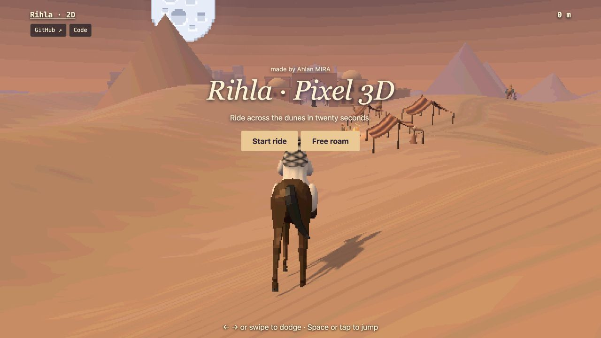

# Rihla · Pixel 3D

A horse, a desert trail, and a medina on the horizon. **Rihla** (رحلة, “journey”) is a pixel-styled 3D browser game by Ahlan MIRA. Ride out across the dunes or leave your horse at the city gate and explore on foot.

**[Play Rihla in your browser](https://rihla-peach.vercel.app/demo-3d/?style=pixel)**

## Your first ride

Choose **Start ride** for a twenty-second dash across the dunes. Dodge the djinn, collect coins, and keep the medina gate in sight.

Choose **Free roam** to take the long way. Follow the eastern trail past the palms of the oasis and through a village toward a ruined mountain pass. Back in the medina, dismount at the fountain and follow the western alley into the Casbah. When night falls, the lanterns mark the way back to the gate.

## Free roam controls

| Action | Keyboard and mouse | Touch |
| --- | --- | --- |
| Move | Arrow keys or WASD / ZQSD | Left joystick |
| Look around | Drag the view, or click to use mouse look on foot | Swipe the scenery |
| Gallop or sprint | Hold Shift while moving | Hold **Gallop** or **Sprint** while moving |
| Dismount or mount nearby | E | **Dismount** or **Mount** |

## Explore the project

The desert uses Three.js and WebGL. A low-resolution render keeps the edges crisp as the camera moves through the 3D world. Horse tracks fade under gusts of sand, caravans follow the ridge, and the campfire lights the tents after dusk. [Explore the 3D source](demo-3d/index.html)

Rihla also includes its original [2D ride](https://rihla-peach.vercel.app/) and a separate [parkour prototype](https://rihla-peach.vercel.app/parkour/).

Created by [Ahlan MIRA](https://github.com/Ahlan06).
